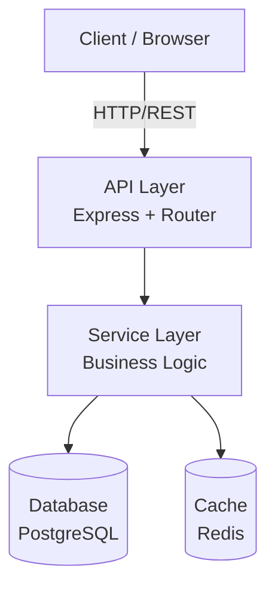

# Doc Generator Skill

Generate high-quality, AI-readable project documentation from structured project data. This skill handles the full lifecycle: loading templates, substituting variables, validating output, and writing files in the correct dependency order.

## Template Loading

Templates live in the bootstrap skill's reference file:

```
.agents/skills/game-dojo-bootstrap/references/templates.md
```

Each template is delimited by a heading like `## GEMINI.md Template`. To load a template:

1. Read the `templates.md` file.
2. Parse the desired section by heading name.
3. Extract the raw Markdown content between that heading and the next `##` heading (or end-of-file).
4. Strip the outer fenced code block wrapper if present.

If a template is not found, generate the document from scratch using the structure guidelines below rather than failing.

## Variable Substitution

Templates use `{{PLACEHOLDER}}` syntax. Replace every placeholder with actual project data before writing.

### Core Variables

| Variable | Source | Example |
|---|---|---|
| `{{PROJECT_NAME}}` | User input | `TaskFlow` |
| `{{PROJECT_DESCRIPTION}}` | User input | `A task management API` |
| `{{TECH_STACK}}` | Gathered spec | `Node.js, Express, PostgreSQL` |
| `{{LANGUAGE}}` | Derived from stack | `TypeScript` |
| `{{FRAMEWORK}}` | Derived from stack | `Express` |
| `{{DATABASE}}` | Derived from stack | `PostgreSQL` |
| `{{PACKAGE_MANAGER}}` | Derived from stack | `npm` |
| `{{PORT}}` | Convention or user | `3000` |
| `{{ARCHITECTURE_DIAGRAM}}` | Generated Mermaid | *(see below)* |
| `{{DIRECTORY_STRUCTURE}}` | Generated tree | *(see below)* |
| `{{SETUP_STEPS}}` | Generated from stack | *(see below)* |
| `{{PROJECT_TYPE}}` | User input | `web-api` |

### Substitution Rules

1. Replace all occurrences of each placeholder — a single placeholder may appear multiple times.
2. After substitution, scan for any remaining `{{...}}` patterns. If found, replace with a sensible default or remove the surrounding section entirely. Never leave raw placeholders in output.
3. Trim excessive blank lines (more than two consecutive) after substitution.

## Generating Mermaid Architecture Diagrams

Build diagrams programmatically from the project's component list.

### Layered Architecture (Web Apps)



### Construction Rules

1. Identify layers from the tech stack: Client → API → Service → Data.
2. Each technology becomes a node with its role as the label and the technology name as a subtitle using `<br/>`.
3. Connect nodes top-down with labeled edges describing the protocol or relationship.
4. Add auxiliary services (cache, queue, auth provider) as side nodes connected to the appropriate layer.
5. Use `graph TD` for vertical layouts (typical for layered architectures) and `graph LR` for pipeline/flow architectures.
6. Quote any node labels containing special characters: `id["Label (info)"]`.

### Validation

After generating a Mermaid block:
- Confirm every node ID is unique.
- Confirm every edge references existing node IDs.
- Confirm no HTML tags appear in labels.
- Confirm special characters in labels are quoted.

## Document-Specific Quality Checklists

### GEMINI.md
- [ ] Contains project-specific coding conventions (not generic boilerplate)
- [ ] References the design system file if one exists
- [ ] Specifies the project's language, framework, and key libraries
- [ ] Includes file naming conventions
- [ ] Includes error handling patterns specific to the stack
- [ ] Includes testing expectations
- [ ] Has a "Tech Stack" or "Stack" section listing exact versions where known

### README.md
- [ ] Title matches project name
- [ ] Description is one clear paragraph
- [ ] Has "Prerequisites" listing required tools and versions
- [ ] Has "Getting Started" with numbered setup steps
- [ ] Has "Project Structure" with directory tree
- [ ] Has "Development" section with common commands (start, test, lint, build)
- [ ] Has "API Reference" or "Usage" section appropriate to project type
- [ ] Has "Contributing" section

### ARCHITECTURE.md
- [ ] Opens with a one-paragraph system overview
- [ ] Contains at least one valid Mermaid diagram
- [ ] Lists every major component with its responsibility
- [ ] Describes data flow between components
- [ ] Documents external service integrations
- [ ] Explains key design decisions with brief rationale

### AGENTS.md
- [ ] Defines the agent's persona and role
- [ ] Lists behavioral guidelines specific to the project
- [ ] Specifies preferred communication style
- [ ] Includes coding standards the agent must follow
- [ ] References other documentation files the agent should consult

### DESIGN_SYSTEM.md
- [ ] Defines color palette with hex values
- [ ] Specifies typography (font families, sizes, weights)
- [ ] Documents spacing scale
- [ ] Lists component patterns (buttons, inputs, cards, etc.)
- [ ] Includes responsive breakpoints if applicable

## File Writing Order and Dependency Chain

Documents must be generated in this order because later documents reference earlier ones:

```
1. GEMINI.md          — foundational rules, referenced by everything
2. AGENTS.md          — agent behavior, references GEMINI.md
3. DESIGN_SYSTEM.md   — design tokens, referenced by GEMINI.md and README.md
4. ARCHITECTURE.md    — system design, needs tech stack from GEMINI.md
5. README.md          — project overview, references all above
6. hooks.json         — automation config, references project structure
7. mcp_config.json    — tool config, needs tech stack decisions
8. Custom SKILL.md    — project skills, need architecture context
```

When regenerating a single file:
1. Read the current versions of all files it depends on (upstream).
2. Regenerate the target file.
3. Check if downstream files reference any content that changed (section headings, file paths). If so, warn the user but do not auto-regenerate downstream files unless explicitly asked.

## Incremental Regeneration

To update a single document without breaking the project:

1. **Read existing file** — preserve any manual edits in sections not covered by the template.
2. **Identify template-managed sections** — sections that match template headings are safe to regenerate.
3. **Merge** — replace template-managed sections with fresh content; keep custom sections intact.
4. **Validate cross-references** — scan other project docs for links or references to the regenerated file's headings. Report any broken references.

## Markdown Validation

Before writing any file, validate:

1. **Headers**: Proper hierarchy (no skipping levels, e.g., `#` → `###`).
2. **Mermaid blocks**: Fenced with ` ```mermaid ` and ` ``` `. All node IDs unique, all edges valid.
3. **Links**: Internal links (`[text](./path)`) point to files that exist or will be created in the same batch.
4. **Code blocks**: All opened with matching close fences. Language identifiers present.
5. **YAML frontmatter**: If present, valid YAML between `---` delimiters.
6. **No placeholders**: Zero remaining `{{...}}` patterns.
7. **No TODOs**: Zero `TODO`, `FIXME`, `HACK`, or `XXX` markers.

## Error Handling

| Situation | Action |
|---|---|
| Template not found | Generate from scratch using the quality checklist as a structural guide |
| Placeholder has no data | Use a sensible default or omit the section; log a warning |
| Mermaid validation fails | Fix the diagram automatically (deduplicate IDs, quote labels) |
| Target file already exists | Read it first; merge template sections with existing custom content |
| JSON validation fails (hooks/mcp) | Pretty-print and re-validate; report specific parse errors |
