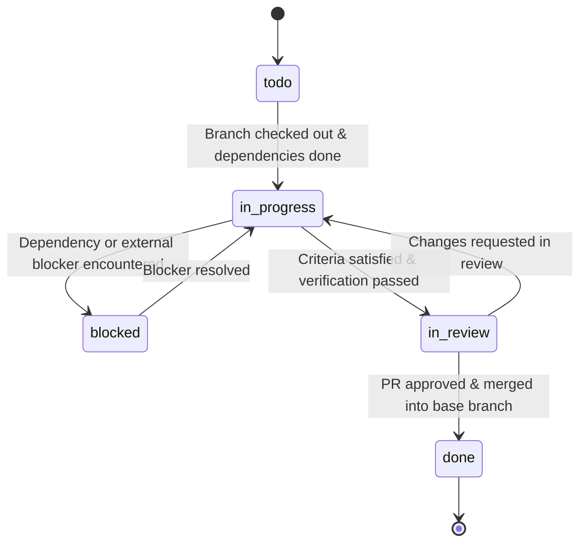

# 🥋 Team Orchestrator

The **Team Orchestrator** skill governs collaborative development across multi-member teams consisting of human engineers and autonomous or guided AI agents. It guarantees that parallel development streams remain completely isolated, deterministic, and conflict-free by anchoring every unit of work to a formal task contract within `.ai-team/`.

---

## 🎯 Architecture & Core Philosophy

In a martial arts dojo, multiple martial artists spar simultaneously on the tatami without colliding because each has a designated zone, well-defined sparring rules, and clear boundaries.

Team Mode applies this exact discipline to software development:

```
                  ┌───────────────────────────────┐
                  │      .ai-team/team.json       │
                  │ (Roster, Roles & Permissions) │
                  └───────────────┬───────────────┘
                                  │
                  ┌───────────────▼───────────────┐
                  │      .ai-team/plan.json       │
                  │ (Phases, Milestones & Locks)  │
                  └───────────────┬───────────────┘
                                  │
         ┌────────────────────────┴────────────────────────┐
         │                                                 │
┌────────▼─────────────────────┐          ┌────────────────▼─────────────┐
│  .ai-team/tasks/TASK-001.json│          │ .ai-team/tasks/TASK-002.json │
│  (Scope: src/client/**)      │          │ (Scope: src/server/**)       │
│  Branch: feature/TASK-001-ui │          │ Branch: feature/TASK-002-api │
└────────┬─────────────────────┘          └────────────────┬─────────────┘
         │                                                 │
         │ (Strict Boundary Enforcement)                   │ (Strict Boundary Enforcement)
         ▼                                                 ▼
┌──────────────────────────────┐          ┌──────────────────────────────┐
│  Engineer A / AI Agent 1     │          │  Engineer B / AI Agent 2     │
│  Isolated Branch & Workspace │          │  Isolated Branch & Workspace │
└──────────────────────────────┘          └──────────────────────────────┘
```

### The Four Invariants of Team Mode

1. **One Branch = One Task:** Every git feature branch maps strictly to a single task definition file in `.ai-team/tasks/<task-id>.json`.
2. **Strict Scope Bounding (`touchesFiles`):** An agent or engineer working on a task may ONLY modify files explicitly matched by `touchesFiles` (or `allowedPaths`) in that task's specification, and must NEVER touch files in `forbiddenPaths`.
3. **Contract Immutability:** Shared contracts located in `docs/contracts/` or `contracts/` are strictly read-only on task feature branches. Any contract modification requires an explicit contract update workflow and Tech Lead approval.
4. **State Machine Integrity:** Tasks transition predictably through states (`todo` → `in_progress` → `in_review` → `done`), accompanied by verification proofs and git commits.

---

## 🔍 Git Branch & Context Auto-Detection

Whenever an AI agent starts a session or begins work, it must first orient itself by determining what task it is executing.

### 1. Branch Detection Protocol

Execute the following git command to determine the active branch:

```powershell
git branch --show-current
```

*(If the repository is in a detached HEAD state, fall back to `git rev-parse --abbrev-ref HEAD`).*

Inspect the returned branch name against standard Game Dojo team branch patterns:

| Pattern | Example | Extracted Task ID |
|---|---|---|
| `feat/<task-id>-<slug>` | `feat/UI-101-dashboard-feed` | `UI-101` |
| `feature/<task-id>-<slug>` | `feature/TASK-003-auth-jwt` | `TASK-003` |
| `task/<task-id>-<slug>` | `task/TASK-010-hardening` | `TASK-010` |
| `fix/<task-id>-<slug>` | `fix/TASK-042-token-leak` | `TASK-042` |
| `refactor/<task-id>-<slug>` | `refactor/TASK-105-clean-routes` | `TASK-105` |
| `chore/<task-id>-<slug>` | `chore/TASK-001-init-skeleton` | `TASK-001` |
| `test/<task-id>-<slug>` | `test/TASK-088-e2e-checkout` | `TASK-088` |
| `hotfix/<task-id>-<slug>` | `hotfix/HOTFIX-001-sec-patch` | `HOTFIX-001` |

#### Regular Expression for Branch Parsing

Use the following regular expression to extract the full task ID and slug:

```regex
^(?:feat|feature|task|fix|refactor|chore|test|docs|hotfix)\/([A-Za-z0-9]+-[0-9]+[A-Za-z]*|[A-Za-z0-9_]+)(?:-([a-z0-9-]+))?$
```

- **Group 1:** `<task-id>` (e.g. `TASK-003`, `UI-101`, `API-201`, `TASK-005A`, `HOTFIX-001`)
- **Group 2:** `<slug>` (e.g. `dashboard-feed`, `auth-jwt`, optional)

---

### 2. Fallback Detection (Git User & Active Tasks)

If the branch name does not contain a task prefix (for example, if the user is on `develop` or a custom scratch branch):

1. **Query Git Identity:**
   ```powershell
   git config user.name; git config user.email
   ```
2. **Resolve Member ID:**
   Look up the name or email in `.ai-team/team.json` under `members` to locate the corresponding member `id` (e.g. `member-lead` or `agent-builder`).
3. **Scan Active Tasks:**
   Inspect all `.json` files in `.ai-team/tasks/`. Filter for tasks where:
   - `assignee.id` (or `assignee`) matches the current member ID, **AND**
   - `status` is `"in_progress"`
4. **Resolution:**
   - If **exactly one** task matches, inform the user:
     > *"Detected active task `TASK-003` for user. Switching to `feat/TASK-003-auth-jwt`."*
   - If **multiple or zero** tasks match, prompt the user or list available `todo` tasks from `.ai-team/tasks/`.

---

### 3. Protected Branch Guardrails

> [!CAUTION]
> Direct commits to `main`, `master`, `develop`, or `release` branches are strictly prohibited in Team Mode.

If the agent detects that the current branch is `main` or `master`:

1. Check `.ai-team/team.json` `policies.allowDirectMainCommits` (or `settings.allowDirectMainCommits`). If `false` (default):
2. **HALT all code modifications immediately.**
3. Guide the developer or create the appropriate feature branch:
   ```powershell
   git checkout -b feat/<task-id>-<slug>
   ```

---

### 4. Loading the Task Specification

Once the `<task-id>` is identified:

1. Locate `.ai-team/tasks/<task-id>.json`.
2. Parse and validate the JSON schema:
   - Verify `id` matches `<task-id>`.
   - Read `touchesFiles` (the canonical boundary array; fall back to `allowedPaths` if legacy).
   - Read `forbiddenPaths`.
   - Read `contractDependencies` (shared API/data models that must remain immutable).
   - Read `dependencies` and `blockedBy`.
   - Read `acceptanceCriteria` and `verification` / `verificationCommands`.
3. If `.ai-team/tasks/<task-id>.json` does not exist:
   > [!WARNING]
   > Branch references non-existent task `<task-id>`. The agent must halt and ask whether to scaffold `.ai-team/tasks/<task-id>.json` using `.agents/skills/game-dojo-bootstrap/references/team-templates.md` or checkout an existing task.

---

## 🛡️ Strict Boundary Enforcement & Scope Containment

Boundary enforcement is the core mechanism preventing parallel team members and AI agents from clobbering each other's code.

### The Boundary Rule (`touchesFiles` Invariant)

> **An agent must NEVER create, edit, or delete any file unless the path matches at least one entry in `touchesFiles` (or `allowedPaths`) AND does NOT match any entry in `forbiddenPaths`.**

```
Boundary Containment Check:
Target File ──► Is in forbiddenPaths? ──► [YES] ──► ❌ REJECT (Forbidden)
                      │
                     [NO]
                      ▼
               Matches touchesFiles?  ──► [NO]  ──► ❌ REJECT (Out of Scope)
                      │
                     [YES]
                      ▼
               ✅ PERMIT OPERATION
```

### Path Matching Rules

- **Glob Support:** Paths ending with `/**` allow all files recursively under that directory (e.g., `src/modules/auth/**`).
- **Exact Matches:** Paths without wildcards match only that explicit file (e.g., `docs/features/auth.md`).
- **Forbidden Overrides:** Entries in `forbiddenPaths` always take precedence over `touchesFiles`.

### Typical `forbiddenPaths` in All Tasks

Unless explicitly granted to a designated architectural or migration task, the following are always forbidden:
- `.ai-team/team.json`
- `.ai-team/plan.json`
- `CODEOWNERS`
- `docs/contracts/**` and `contracts/**` (immutable without Tech Lead approval)
- `package.json` / `package-lock.json`
- Database schema and migration directories (e.g. `prisma/schema.prisma`, `migrations/**`)

---

### Automated Boundary Verification Script

Before transitioning a task to `in_review` or submitting a PR, run this verification script in PowerShell to guarantee zero boundary violations:

```powershell
$taskId = "<task-id>"
$taskFile = ".ai-team\tasks\$taskId.json"
$task = Get-Content $taskFile -Raw | ConvertFrom-Json
$allowed = if ($task.touchesFiles) { $task.touchesFiles } else { $task.allowedPaths }
$forbidden = $task.forbiddenPaths
$baseBranch = if ($task.baseBranch) { $task.baseBranch } else { "main" }

# Get all modified and untracked files
$modified = git diff --name-only "$baseBranch...HEAD"
$violations = @()

foreach ($file in $modified) {
    # Check forbidden paths first
    $isForbidden = $false
    foreach ($f in $forbidden) {
        $pattern = '^' + [regex]::Escape($f).Replace('\/\*\*', '(/.*)?').Replace('\*', '[^/]*') + '$'
        if ($file -match $pattern) { $isForbidden = $true; break }
    }
    if ($isForbidden) {
        $violations += "FORBIDDEN: $file"
        continue
    }

    # Check allowed touchesFiles
    $isAllowed = $false
    foreach ($a in $allowed) {
        $pattern = '^' + [regex]::Escape($a).Replace('\/\*\*', '(/.*)?').Replace('\*', '[^/]*') + '$'
        if ($file -match $pattern) { $isAllowed = $true; break }
    }
    if (-not $isAllowed) {
        $violations += "OUT_OF_BOUNDS: $file"
    }
}

if ($violations.Count -gt 0) {
    Write-Error "Boundary violation detected:`n$($violations -join "`n")"
} else {
    Write-Host "✅ Boundary compliance verified: all modified files within touchesFiles."
}
```

---

### Handling Out-of-Bounds Changes

If during implementation the agent realizes a file outside `touchesFiles` must be modified (e.g., adding an export to `src/index.ts` or registering a route in `src/router.ts`):

1. **DO NOT edit the out-of-bounds file directly.**
2. **Perform Peer Collision Check:**
   - Scan other task files in `.ai-team/tasks/*.json`.
   - Check if any active task (`status: "in_progress"`) lists the target file in its `touchesFiles`.
   - If another task owns the file, **DO NOT TOUCH IT**. Flag a dependency or coordinate via shared interfaces.
3. **Shared Resource Lock Protocol:**
   - Check `sharedResourceLocks` in `.ai-team/plan.json`.
   - If the file is a managed shared resource (like `package.json` or `src/router.ts`):
     - Check if `lockedByTaskId` is `null`.
     - If unlocked, acquire the lock temporarily or request architectural approval.
4. **Scope Expansion Procedure:**
   - If the file has no conflicts and modification is strictly necessary:
     - Record the scope expansion in the task's `changelog`.
     - Add the specific path to `touchesFiles` (and `allowedPaths`) in `.ai-team/tasks/<task-id>.json`.
     - Explain the rationale clearly in the commit message and PR description.

---

## ⛓️ Dependency Verification & Blockers

Before work on any task begins, all upstream dependencies must be confirmed as completed.

### Dependency Evaluation Algorithm

```
                    ┌──────────────────────────────┐
                    │ Read task.json dependencies  │
                    └──────────────┬───────────────┘
                                   │
                                   ▼
                       Dependencies empty?
                         │             │
                    [YES]│             │[NO]
                         ▼             ▼
             ┌──────────────┐   ┌──────────────────────────────┐
             │ Status: OK   │   │ For each dependencyTaskId:   │
             │ Ready to run │   │ Read tasks/<dep-id>.json     │
             └──────────────┘   └──────────────┬───────────────┘
                                               │
                                               ▼
                                    Are ALL dependencies
                                    status == "done"?
                                      │              │
                                 [YES]│              │[NO]
                                      ▼              ▼
                               ┌─────────────┐ ┌────────────────────────┐
                               │ Status: OK  │ │ Status: BLOCKED        │
                               │ Start task  │ │ Record blockerReason   │
                               └─────────────┘ └────────────────────────┘
```

### Steps for Dependency Checking

1. Read `dependencies: []` from `.ai-team/tasks/<task-id>.json`.
2. If the array is non-empty, loop through each `<dependency-id>`:
   - Check that `.ai-team/tasks/<dependency-id>.json` exists.
   - Inspect its `status`.
   - If `status !== "done"`:
     - Mark current task as `blocked`.
     - Record in `blockers` array:
       ```json
       {
         "id": "BLOCK-DEP-{{DEPENDENCY_ID}}",
         "reason": "Prerequisite task {{DEPENDENCY_ID}} is currently {{STATUS}}, must be done.",
         "blockedAt": "{{CURRENT_ISO_TIMESTAMP}}",
         "resolvedAt": null
       }
       ```
     - Notify the user with exact details on which tasks are blocking progress.
     - **Do not proceed with implementation until dependencies are resolved.**

### Circular Dependency Check

Ensure no circular chains exist (e.g. `TASK-001` depends on `TASK-002`, and `TASK-002` depends on `TASK-001`). If a cycle is detected, halt immediately and alert the Tech Lead to adjust `.ai-team/plan.json`.

---

## 🔄 Task Status Lifecycle & Transitions

Every task progresses through a rigorous state machine with automated checks and audit logs at each boundary.



### State Machine Transition Rules

#### 1. Transition: `todo` → `in_progress`

**Prerequisites:**
- Git branch name matches `feature/<task-id>-<slug>` (or appropriate prefix).
- All items in `dependencies` have `status: "done"`.
- Assignee is confirmed.

**Actions:**
1. Update `.ai-team/tasks/<task-id>.json`:
   - Set `"status": "in_progress"`.
   - Set `"schedule.startedAt": "<current_iso_timestamp>"`.
   - Append to `"changelog"`:
     ```json
     {
       "timestamp": "<current_iso_timestamp>",
       "author": "<assignee_id>",
       "action": "status_change",
       "details": "Task moved from todo to in_progress on branch feature/<task-id>-<slug>"
     }
     ```
2. Commit task state:
   ```powershell
   git add .ai-team/tasks/<task-id>.json; git commit -m "chore(task): start <task-id> [in_progress]"
   ```

---

#### 2. Transition: `in_progress` → `in_review`

**Prerequisites:**
- All `acceptanceCriteria` items are satisfied and evidenced.
- All commands in `verificationCommands` (and `verification.testCommand` / `verification.lintCommand`) have executed and exited with code 0:
  ```powershell
  npm run lint; npm run typecheck; npm test
  ```
- **Boundary Verification:** Run the Automated Boundary Verification Script (or git diff against base branch):
  ```powershell
  git diff --name-only main...HEAD
  ```
  Every single file listed must match `touchesFiles` (or `allowedPaths`).
- **Contract Conformance Check:** Verify shared contracts remain unchanged:
  ```powershell
  git diff main -- docs/contracts contracts
  ```
  Must output zero changes (shared contracts are immutable on feature branches).

**Actions:**
1. Update `.ai-team/tasks/<task-id>.json`:
   - Set `"status": "in_review"`.
   - Set `"schedule.completedAt": "<current_iso_timestamp>"`.
   - Append verification results and timestamp to `"changelog"`.
2. Commit implementation and task update:
   ```powershell
   git add -A; git commit -m "<type>(<slug>): [<task-id>] <summary_of_changes>"
   ```
3. Generate Pull Request description and initiate PR workflow.

---

#### 3. Transition: `in_review` → `done`

**Prerequisites:**
- Code review approved by mandatory reviewers specified in `CODEOWNERS` and `reviewers`.
- Pull Request merged into target default branch (e.g. `main` or `develop`).

**Actions:**
1. Update `.ai-team/tasks/<task-id>.json`:
   - Set `"status": "done"`.
   - Set `"schedule.mergedAt": "<current_iso_timestamp>"`.
   - Set `"pullRequest.merged": true`.
   - Append merge details to `"changelog"`.
2. Commit and push task update:
   ```powershell
   git add .ai-team/tasks/<task-id>.json; git commit -m "chore(task): complete <task-id> [done]"
   ```
3. **Notify Downstream Tasks:**
   Scan `.ai-team/tasks/*.json` for any task listing `<task-id>` in its `dependencies`. If all other dependencies for that task are now `done`, remove blocker status and mark ready for work.

---

#### 4. Transition: `in_progress` → `blocked`

**Prerequisites:**
- An external dependency failure, unmerged prerequisite, or architectural conflict prevents progress.

**Actions:**
1. Update `.ai-team/tasks/<task-id>.json`:
   - Set `"status": "blocked"`.
   - Add new entry to `blockers`:
     ```json
     {
       "id": "BLOCK-<timestamp>",
       "reason": "<detailed_explanation>",
       "blockedAt": "<current_iso_timestamp>",
       "resolvedAt": null
     }
     ```
2. Commit blocker state so team members can see it:
   ```powershell
   git add .ai-team/tasks/<task-id>.json; git commit -m "chore(task): mark <task-id> blocked [blocked]"
   ```

---

## 🚀 Pull Request Workflow & Review Governance

In Team Mode, PR creation is structured to provide reviewers with immediate clarity on boundaries and verification proofs.

### 1. Commit Message Convention

All commits within a task branch must reference the task ID:

```
<type>(<scope>): [<task-id>] <imperative description>

[optional body describing technical decisions]
```

**Examples:**
- `feat(auth): [TASK-003] implement jwt verification middleware`
- `fix(auth): [TASK-003] handle expired tokens with 401 response`
- `test(auth): [TASK-003] add test suite for token revocation`

---

### 2. Auto-Generated Pull Request Description

When transitioning to `in_review`, generate a PR description adhering to the following standard template:

```markdown
## 🥋 Pull Request: [{{TASK_ID}}] {{TASK_TITLE}}

### 📋 Overview
- **Task ID:** [{{TASK_ID}}](.ai-team/tasks/{{TASK_ID}}.json)
- **Task Type:** `{{TASK_TYPE}}`
- **Assignee:** @{{ASSIGNEE_GITHUB}}
- **Target Branch:** `{{DEFAULT_BRANCH}}`

### 🎯 Changes Made
- {{SUMMARY_BULLET_1}}
- {{SUMMARY_BULLET_2}}
- {{SUMMARY_BULLET_3}}

### 🛡️ Boundary Compliance Audit
All files modified in this PR comply strictly with task `touchesFiles`:
| Modified File | Allowed Path Pattern | Status |
|---|---|---|
| `src/modules/auth/jwt.ts` | `src/modules/auth/**` | ✅ Valid |
| `tests/modules/auth/jwt.test.ts` | `tests/modules/auth/**` | ✅ Valid |
| `docs/features/auth.md` | `docs/features/**` | ✅ Valid |

### 📜 Contract Conformance
- **Referenced Contracts:** `docs/contracts/api-spec.json#/paths/~1auth`
- **Contract Mutations:** None (shared contracts unmodified)

### 🧪 Verification Record
All verification commands executed and passed:
- [x] `npm run lint` — 0 errors, 0 warnings
- [x] `npm run typecheck` — TypeScript compilation clean
- [x] `npm test -- tests/modules/auth` — 8 tests passed, 100% assertions green

### 👥 Required Reviewers
Based on `CODEOWNERS` and task specifications:
- @{{REVIEWER_1_GITHUB}}
- @{{REVIEWER_2_GITHUB}}
```

---

### 3. PR Creation Command

Create the PR using the GitHub CLI (`gh`):

```powershell
git push -u origin feat/<task-id>-<slug>; gh pr create --title "{{TASK_TYPE}}({{TASK_SLUG}}): [{{TASK_ID}}] {{TASK_TITLE}}" --body-file .ai-team/pr-description.md
```

If `gh` CLI is unavailable, output the markdown body and the web creation URL to the user.

---

## 📋 Dynamic Task Re-Planning & Decomposition

Real-world development frequently uncovers unforeseen complexity. When a task cannot be completed within its designated boundaries, apply dynamic re-planning.

### Criteria for Task Splitting
Split a task into subtasks when:
- The task scope exceeds 8 estimated hours.
- Implementation requires touching more than 10 files across multiple domains.
- A new shared service or schema migration is discovered that multiple peers will need.

### Task Splitting Procedure

1. **Keep Parent Task Intact:** Keep `TASK-005` as the parent tracking item or milestone deliverable.
2. **Create Child Tasks:**
   - Create `.ai-team/tasks/TASK-005A.json` (e.g. data layer and repository).
   - Create `.ai-team/tasks/TASK-005B.json` (e.g. API endpoint and controller, dependent on `TASK-005A`).
3. **Register in `plan.json`:**
   - Add new task IDs to the respective milestone's `taskIds` array in `.ai-team/plan.json`.
4. **Notify Team:**
   - Update team roadmap so peer agents know about the split and dependency sequence.

---

## 🥋 Agent Step-by-Step Execution Protocol

When operating in a Game Dojo workspace with Team Mode enabled, follow this protocol on every invocation:

| Step | Action | Command / Check |
|---|---|---|
| **1. Detect Branch** | Find active git branch | `git branch --show-current` (or `git rev-parse --abbrev-ref HEAD`) |
| **2. Guard Protected Branch** | Abort if on `main`/`master` | Checkout or switch to `feat/<task-id>-<slug>` |
| **3. Load Task Contract** | Read `.ai-team/tasks/<task-id>.json` | Parse JSON, inspect `touchesFiles`, `contractDependencies`, & `dependencies` |
| **4. Verify Dependencies** | Check all dependencies in `.ai-team/tasks/` | Ensure each dependency has `status: "done"` and contracts are intact |
| **5. Claim Task** | If status is `todo`, move to `in_progress` | Update `startedAt`, write changelog, commit |
| **6. Implement within Bounds** | Perform coding tasks | Verify every file path against `touchesFiles` before editing |
| **7. Execute Verification** | Run tests, linters, type checks | Execute `verificationCommands` (and `verification.testCommand`) |
| **8. Audit Git Diff** | Confirm zero out-of-bounds edits | Run Automated Boundary Verification Script (`git diff --name-only main...HEAD`) |
| **9. Transition to Review** | Move status to `in_review` | Update `completedAt`, write PR body, push branch |
| **10. PR Handoff** | Create PR and assign reviewers | Call `gh pr create` or supply PR markdown |

---

## ⚠️ Troubleshooting & Edge Cases

### 1. Detached HEAD
If `git branch --show-current` returns empty or `git rev-parse --abbrev-ref HEAD` returns `HEAD`:
- The repository is in a detached state.
- Query `git log -1` to identify the last commit message containing `[TASK-XXX]`.
- Checkout a named feature branch: `git checkout -b feat/<task-id>-<slug>`.

### 2. Task JSON Corrupted or Missing
- If `.ai-team/tasks/<task-id>.json` is missing or invalid JSON:
  - Do not guess or continue blindly.
  - Re-instantiate the task from `.agents/skills/game-dojo-bootstrap/references/team-templates.md` or ask the user for specification details.

### 3. Out-of-Sync Main Branch
Before transitioning to `in_review`, if the base branch has moved forward:
```powershell
git fetch origin main; git rebase origin/main
```
Re-run all `verificationCommands` post-rebase to ensure no integration regressions occurred.

### 4. Emergency Hotfix Mode
If a critical production bug requires an immediate fix outside standard milestone planning:
- Use branch prefix `hotfix/HOTFIX-XXX-<slug>`.
- Create `.ai-team/tasks/HOTFIX-XXX.json` with `priority: "critical"` and `type: "fix"`.
- Require Tech Lead review before merging directly to `main`.
