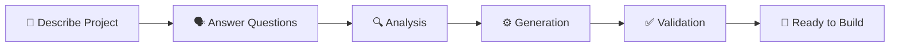

# 🥋 Game Dojo — Design System

The Game Dojo design system establishes the visual identity, formatting conventions, and component patterns used across all generated documentation and UI elements. It draws inspiration from the **martial arts dojo** — disciplined, focused, and elegant.

---

## Visual Identity

### Theme: Zen Dojo
The Game Dojo aesthetic is **dark, calm, and focused** — like a training hall at dawn. Designs favor:
- Clean negative space over visual clutter
- Sharp, purposeful accents over gratuitous decoration
- Monospaced elements for code, proportional for prose
- A sense of quiet confidence and mastery

### Logo Usage
The primary identifier is the emoji mark **🥋** followed by the wordmark **Game Dojo** in bold. Always use this format in headers and titles:
```markdown
# 🥋 Game Dojo
```

---

## Color Palette

### Dark / Zen Theme (Primary)

| Role | Name | Hex | Usage |
|---|---|---|---|
| Background | Obsidian | `#0D1117` | Primary background, document body |
| Surface | Charcoal | `#161B22` | Cards, panels, elevated surfaces |
| Border | Ash | `#30363D` | Dividers, borders, subtle separators |
| Text Primary | Rice Paper | `#E6EDF3` | Body text, headings |
| Text Secondary | Stone | `#8B949E` | Captions, metadata, muted text |
| Accent Primary | Crimson Obi | `#E05252` | Primary actions, important highlights |
| Accent Secondary | Jade | `#3FB950` | Success states, confirmations, checkmarks |
| Accent Tertiary | Golden Bell | `#D29922` | Warnings, attention-needed states |
| Accent Quaternary | Sky Scroll | `#58A6FF` | Links, informational highlights |
| Code Background | Tatami | `#1A1F25` | Inline code, code blocks |

### Light Theme (Alternative)

| Role | Name | Hex | Usage |
|---|---|---|---|
| Background | Shoji Screen | `#FFFFFF` | Primary background |
| Surface | Washi | `#F6F8FA` | Cards, panels |
| Border | Bamboo | `#D0D7DE` | Dividers, borders |
| Text Primary | Ink | `#1F2328` | Body text, headings |
| Text Secondary | Graphite | `#656D76` | Captions, metadata |
| Accent Primary | Crimson Obi | `#CF222E` | Primary actions |
| Accent Secondary | Jade | `#1A7F37` | Success states |
| Accent Tertiary | Golden Bell | `#9A6700` | Warnings |
| Accent Quaternary | Sky Scroll | `#0969DA` | Links |
| Code Background | Sand Garden | `#F6F8FA` | Code blocks |

---

## Typography

### Font Stack
```css
/* Prose */
font-family: -apple-system, BlinkMacSystemFont, "Segoe UI", "Noto Sans", Helvetica, Arial, sans-serif;

/* Code */
font-family: "JetBrains Mono", "Fira Code", "Cascadia Code", ui-monospace, SFMono-Regular, "SF Mono", Menlo, Consolas, monospace;
```

### Heading Hierarchy

| Level | Usage | Formatting |
|---|---|---|
| `# H1` | Document title only — one per document | Bold, with emoji prefix (e.g., `# 🥋 Game Dojo`) |
| `## H2` | Major sections | Bold, preceded by a horizontal rule (`---`) |
| `### H3` | Subsections within a major section | Bold |
| `#### H4` | Sub-subsections, rarely needed | Bold |
| `**Bold**` | Emphasis within paragraphs | Used for key terms on first mention |
| `*Italic*` | Soft emphasis, citations, or asides | Used sparingly |
| `` `Code` `` | File names, commands, config keys, values | Always use for technical identifiers |

### Heading Rules
- Every document starts with exactly one `# H1` heading.
- Major sections (`## H2`) are separated by horizontal rules (`---`).
- Never skip heading levels (e.g., don't jump from `## H2` to `#### H4`).
- Keep headings concise — under 8 words when possible.

---

## Component Patterns

### Info Cards (GitHub Alerts)
Use GitHub-style alerts for callouts. Never stack more than two consecutively.

```markdown
> [!NOTE]
> Background context or implementation details.

> [!TIP]
> Performance optimization or best-practice suggestion.

> [!IMPORTANT]
> Essential requirement or critical step.

> [!WARNING]
> Breaking change or compatibility issue.

> [!CAUTION]
> High-risk action that could cause data loss.
```

**When to use each:**

| Alert | Purpose | Color Association |
|---|---|---|
| NOTE | Explanation, context, "how it works" | Sky Scroll (blue) |
| TIP | Optimization, shortcut, pro tip | Jade (green) |
| IMPORTANT | Must-know, required step | Crimson Obi (red) |
| WARNING | Potential problem, watch out | Golden Bell (yellow) |
| CAUTION | Dangerous action, irreversible | Crimson Obi (red) |

### Tables
- Always include a header row with alignment.
- Use `|---|` separators (left-aligned by default).
- Keep cell content concise — no multi-line cells.
- Use tables for structured comparisons, configuration references, and option lists.

### Code Blocks
- Always specify the language for syntax highlighting.
- Use triple backticks with the language identifier: ` ```typescript `, ` ```json `, ` ```bash `.
- For shell commands, use `powershell` on Windows contexts and `bash` for cross-platform.
- Keep code blocks focused — show only the relevant snippet, not entire files.

### Checklists
Use Markdown task lists for actionable items and summaries:
```markdown
- [x] Completed item
- [ ] Pending item
```

---

## Emoji Usage Guide

Emojis serve as **visual anchors** for section types across all Game Dojo documentation. Use them consistently in headings and list items.

### Section Markers

| Emoji | Meaning | Usage |
|---|---|---|
| 🥋 | Game Dojo brand | Document titles, project identity |
| 🎯 | Goals / Objectives | Goal sections, target outcomes |
| 🏗️ | Architecture | System architecture, structure sections |
| ⚙️ | Configuration / Setup | Config files, setup instructions |
| 🔧 | Tools / Utilities | Tooling sections, utility references |
| 📋 | Checklists / Summaries | Summary sections, completion checklists |
| 🎤 | Input / Accept | User input phases, description acceptance |
| 🗣️ | Interview / Questions | Question rounds, clarification phases |
| 🔍 | Analysis / Research | Analysis phases, investigation sections |
| ✅ | Validation / Success | Validation phases, success confirmations |
| 📦 | Packages / Dependencies | Dependency lists, package sections |
| 🚀 | Launch / Deploy | Deployment, quick start, getting started |
| 💡 | Tips / Ideas | Tips, suggestions, ideas |
| ⚠️ | Warnings | Warning callouts in prose |
| 🛡️ | Security | Security considerations |
| 🧪 | Testing | Test sections, QA |
| 📖 | Documentation | Doc references, reading sections |
| 🔌 | Plugins / Integrations | Plugin configs, integration sections |
| 🪝 | Hooks | Lifecycle hooks, event handlers |
| 🌐 | Web / Network | API endpoints, network configs |

### Emoji Rules
- Use **one emoji per heading**, placed before the text: `## 🎯 Goals`
- Never use emoji in `# H1` titles except the brand mark `🥋`
- Do not use emoji in body text paragraphs — reserve them for headings and list item prefixes.
- Maintain consistency: once an emoji is associated with a concept, always use that same emoji for it.
- Do not invent new emoji associations without adding them to this guide.

---

## Mermaid Diagram Styling

### Supported Diagram Types
Only use these Mermaid diagram types in Game Dojo documentation:

| Type | Syntax | Best For |
|---|---|---|
| Flowchart | `flowchart TD` / `flowchart LR` | Workflows, pipelines, decision trees |
| Sequence | `sequenceDiagram` | API flows, component interactions |
| State | `stateDiagram-v2` | Lifecycle states, status transitions |
| Class | `classDiagram` | Data models, type relationships |
| ER | `erDiagram` | Database schemas, entity relationships |
| XY Chart | `xychart-beta` | Data visualization, comparisons |

### Diagram Conventions
- **Always use `flowchart`** over `graph` for flow diagrams (newer syntax, more features).
- **Prefer `LR` (left-to-right)** for pipelines and sequential flows.
- **Prefer `TD` (top-down)** for hierarchies and tree structures.
- **Quote all labels** containing special characters: `id["Label (with parens)"]`
- **Never use HTML** in diagram labels.
- Keep diagrams **compact** — 5–10 nodes maximum. Split complex diagrams into multiple smaller ones.

### Flowchart Node Styles

```
Standard node:      A["Label"]
Rounded node:       A("Label")
Stadium node:       A(["Label"])
Diamond (decision): A{"Label"}
Hexagon:            A{{"Label"}}
```

### Example Diagram



---

## Markdown Formatting Conventions

### Document Structure
Every generated Markdown document should follow this structure:

```markdown
# 🥋 Document Title

Brief one-paragraph description of what this document covers.

---

## Section One

Content...

---

## Section Two

Content...
```

### Spacing Rules
- One blank line before and after headings.
- One blank line before and after code blocks.
- One blank line before and after tables.
- One blank line before and after blockquotes/alerts.
- No trailing whitespace on any line.
- Exactly one newline at end of file.

### Link Formatting
- Use descriptive link text, never "click here" or raw URLs.
- For file references: `[filename.ext](file:///path/to/filename.ext)`
- For section references: `[Section Name](#section-name)`
- For external links: `[Display Text](https://example.com)`

### List Formatting
- Use `-` (hyphens) for unordered lists, not `*` or `+`.
- Use `1.` for ordered lists (auto-numbering).
- Indent nested lists with 2 spaces.
- Keep list items to a single line when possible.

---

## File-Specific Formatting

### GEMINI.md
- Start with project name and one-line identity statement in a blockquote.
- Use tables for conventions and standards.
- Use checklists for validation criteria.

### SKILL.md
- Must begin with YAML frontmatter containing `name` and `description`.
- First section after frontmatter should be a brief overview.
- Include a "When to Use" section.
- Include step-by-step instructions.

### README.md
- Start with `# 🥋 Project Name` and a bold one-liner.
- Include a Mermaid diagram for workflows.
- Include a file tree using code blocks.
- End with a "Built With" or "License" section.

### plugin.json / hooks.json / mcp_config.json
- Use 2-space indentation.
- Use `camelCase` for all keys.
- Include inline comments only if the format supports them (JSON does not — add a companion doc if explanation is needed).
