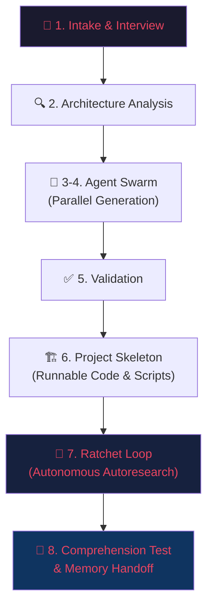

# 🥋 Game Dojo 2.0

**Autonomous AI-powered project bootstrapping for Antigravity IDE — describe your project, get a fully configured, runnable, self-improving workspace.**

---

## What Is Game Dojo?

Game Dojo is an intelligent, autonomous project bootstrapping and engineering system that lives inside [Antigravity IDE](https://antigravity.dev). Inspired by Andrej Karpathy's latest works on **Software 3.0**, **Autoresearch ratchet loops**, **Agent Swarms**, **LLM OS**, and **Agentic Engineering**, Game Dojo transforms plain-language project ideas into fully scaffolded, verified, runnable, and continuously improved workspaces.

It produces complete, production-ready project configurations and runnable code including:
- **`GEMINI.md`** — Master AI rules, autonomy thresholds, and coding standards tailored to your project
- **`AGENTS.md`** — Behavioral rules and swarm topologies for AI agents
- **Executable Project Skeleton** — Runnable starter code, manifests (`package.json`, `pyproject.toml`), configs, schemas, and setup scripts (`setup.ps1` / `setup.sh`)
- **Specialized Skills** — 12 built-in Game Dojo skills plus access to the **1,320+ pre-built skills** in the local skills library
- **Plugin & Hook Configs** — `plugin.json` manifests, `hooks.json` lifecycle automation with PowerShell quality scripts
- **MCP Integrations** — `mcp_config.json` for Model Context Protocol servers
- **Design Systems & Docs** — `DESIGN_SYSTEM.md`, `ARCHITECTURE.md`, `REQUIREMENTS.md`, and complete `/docs`

Every generated file is **complete and immediately usable** — zero TODOs, zero placeholders, zero stubs.

---

## Game Dojo 2.0 Core Features

### 1. 🔄 The Ratchet Loop (Karpathy Autoresearch)
An autonomous hill-climbing quality engine:
- Measures a composite quality score (0–100) across completeness, validity, cross-reference integrity, coverage, and AI readability.
- Targets the lowest-scoring component, applies atomic improvements, and re-validates.
- **Improved?** Ratchet forward with a `ratchet: [fix]` git commit.
- **Regressed?** Discard immediately via `git reset --hard HEAD~1` and try another vector.
- Full audit trail recorded in `ratchet-log.tsv`.

### 2. 🏛️ Agent Swarm Orchestration
Parallel multi-agent generation using the **Shepherd/Search Agent pattern**:
- **Architect (Shepherd):** Holds the master specification, coordinates execution, and performs conflict-free merges.
- **Specialist Workers:** Research Agent, Doc Generator, Skill Builder, and Integration Engineer work simultaneously on isolated branches.
- **Validator & Tester:** Autonomous quality review and comprehension gates.

### 3. 🧪 AI Comprehension Testing
The gold standard for AI-readability: spawns a fresh subagent with **ZERO prior context** and tests cold-start understanding across 5 dimensions (Project Identity, Tech Stack, Feature Implementation, Architecture, Deployment) scoring 0–100. Low scores trigger targeted documentation repairs.

### 4. 🌙 Overnight Build (`/goal` Mode)
Full 14-step hands-off autonomous pipeline:
- Auto-interviews with smart defaults.
- Spawns the agent swarm, builds core features, executes test suites (`npm test`), auto-heals failures, runs 2 hours of ratchet iterations, and compiles a comprehensive `docs/MORNING_REPORT.md`.

### 5. 🩹 Self-Healing Engine
Deterministic, non-destructive auto-repair for JSON syntax errors, YAML frontmatter defects in `SKILL.md`, broken Markdown relative links/anchors, cross-reference inconsistencies, and encoding/line-ending issues.

### 6. 🧠 Adaptive Memory Store
Cross-project learning store at `C:\Users\Vinod krishna\antigravity_skills\.game-dojo-memory\`:
- `decision-log.jsonl` tracks historical choices across sessions.
- `preference-profile.json` refines user defaults over time.
- `stack-performance.json` identifies highest-performing tech combinations.
- `template-patches.jsonl` detects manual user patterns to evolve base templates.

### 7. 📚 1,320+ Local Skills Archive Integration
Direct search and import from `C:\Users\Vinod krishna\antigravity_skills` across DevOps, Full-Stack Web, AI Agents, Security Auditing, Testing, and Mobile architectures before writing skills from scratch.

---

## The 8-Phase Pipeline



| Phase | Key Activity | Output |
|---|---|---|
| **1. Intake & Interview** | Batched Q&A with smart defaults (or full auto) | Structured Requirements JSON |
| **2. Architecture Analysis** | Stack selection, architecture pattern, trade-offs | Architecture Blueprint |
| **3-4. Agent Swarm** | Parallel doc, skill, and config authoring | Merged Workspace Specification |
| **5. Validation** | Syntax, frontmatter, and link integrity verification | Initial Quality Score |
| **6. Project Skeleton** | Manifests, configs, setup scripts (`setup.ps1`), starter code | Runnable Project Codebase |
| **7. Ratchet Loop** | Hill-climbing autoresearch loop with git tracking | 95+ Quality Score & `ratchet-log.tsv` |
| **8. Comprehension & Memory** | Cold-start AI test (5 questions) + memory update | Validated Workspace & Handoff |

---

## Skills Catalog

Game Dojo 2.0 provides 12 specialized skills in `.agents/skills/`:

| Skill | Purpose |
|---|---|
| [`game-dojo-bootstrap`](file:///d:/Game_dojo/.agents/skills/game-dojo-bootstrap/SKILL.md) | Master 8-phase bootstrapping coordinator |
| [`ratchet-loop`](file:///d:/Game_dojo/.agents/skills/ratchet-loop/SKILL.md) | Karpathy autoresearch generate → validate → score → fix → commit/reset loop |
| [`comprehension-test`](file:///d:/Game_dojo/.agents/skills/comprehension-test/SKILL.md) | Cold-start 5-question AI readability benchmark (0–100) |
| [`agent-swarm`](file:///d:/Game_dojo/.agents/skills/agent-swarm/SKILL.md) | Shepherd/Search Agent multi-agent parallel orchestration |
| [`overnight-build`](file:///d:/Game_dojo/.agents/skills/overnight-build/SKILL.md) | 14-step autonomous overnight pipeline for `/goal` mode |
| [`project-skeleton`](file:///d:/Game_dojo/.agents/skills/project-skeleton/SKILL.md) | Runnable starter code, manifests, CI/CD, and setup scripts generator |
| [`self-healing`](file:///d:/Game_dojo/.agents/skills/self-healing/SKILL.md) | Autonomous syntax, link, frontmatter, and config repair |
| [`adaptive-memory`](file:///d:/Game_dojo/.agents/skills/adaptive-memory/SKILL.md) | Cross-project memory store, preference learning, and template evolution |
| [`doc-generator`](file:///d:/Game_dojo/.agents/skills/doc-generator/SKILL.md) | Specification document generation and template rendering |
| [`skill-crafter`](file:///d:/Game_dojo/.agents/skills/skill-crafter/SKILL.md) | Custom `SKILL.md` authoring tailored to project workflows |
| [`ecosystem-scanner`](file:///d:/Game_dojo/.agents/skills/ecosystem-scanner/SKILL.md) | Marketplace plugin and local skill archive discovery |
| [`project-validator`](file:///d:/Game_dojo/.agents/skills/project-validator/SKILL.md) | Comprehensive 8-point project verification suite |

---

## Workspace Structure

```
Game_dojo/
├── GEMINI.md                          # Master AI rules and autonomy thresholds
├── AGENTS.md                          # Agent behavioral protocols & swarm rules
├── README.md                          # This file
├── DESIGN_SYSTEM.md                   # Visual identity, formatting, and design tokens
│
├── .agents/
│   ├── hooks.json                     # SessionStart & PostToolUse lifecycle hooks
│   ├── mcp_config.json                # MCP tool configurations
│   ├── MCP_GUIDE.md                   # MCP server usage and schema guide
│   ├── plugins/
│   │   └── game-dojo/
│   │       ├── plugin.json            # Plugin manifest
│   │       └── rules/AGENTS.md        # Plugin behavior rules
│   ├── scripts/
│   │   ├── welcome.ps1                # Interactive session greeting hook
│   │   ├── lint-markdown.ps1          # Markdown quality and heading linter hook
│   │   ├── validate-json.ps1          # JSON syntax validator hook
│   │   └── validation-reminder.ps1    # Post-invocation reminder hook
│   └── skills/                        # 12 Game Dojo 2.0 Skills
│       ├── adaptive-memory/SKILL.md
│       ├── agent-swarm/SKILL.md
│       ├── comprehension-test/SKILL.md
│       ├── doc-generator/SKILL.md
│       ├── ecosystem-scanner/SKILL.md
│       ├── game-dojo-bootstrap/SKILL.md
│       ├── overnight-build/SKILL.md
│       ├── project-skeleton/SKILL.md
│       ├── project-validator/SKILL.md
│       ├── ratchet-loop/SKILL.md
│       ├── self-healing/SKILL.md
│       └── skill-crafter/SKILL.md
│
└── docs/
    ├── ARCHITECTURE.md                # System design & Game Dojo 2.0 autonomous architecture
    ├── WORKFLOW_GUIDE.md              # End-to-end recipe sharing app walkthrough
    └── LOCAL_SKILLS_INDEX.md          # 1,320+ pre-built skills library reference
```

---

## Quick Start

1. **Open Antigravity IDE** with the Game Dojo workspace loaded.
2. **Describe your project**:
   > "Build me a collaborative kanban board with Next.js, Supabase, Tailwind, and real-time updates."
3. **Choose your autonomy level**:
   - **Guided (Default):** Answer quick batched questions with smart defaults.
   - **Overnight Mode:** Type `/goal Build me a full-stack e-commerce app overnight` and review the completed build and morning report when you return.
4. **Run the generated setup script**:
   ```powershell
   .\scripts\setup.ps1
   ```
5. **Start developing**:
   ```bash
   npm run dev
   ```

---

## License

Part of the Antigravity ecosystem. Built for autonomous software engineering.
