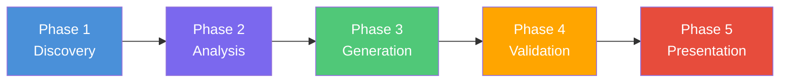
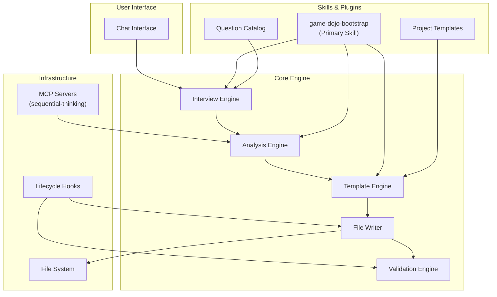
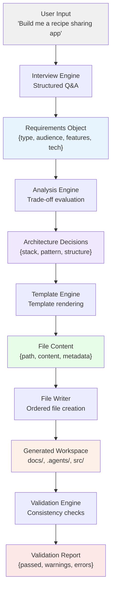
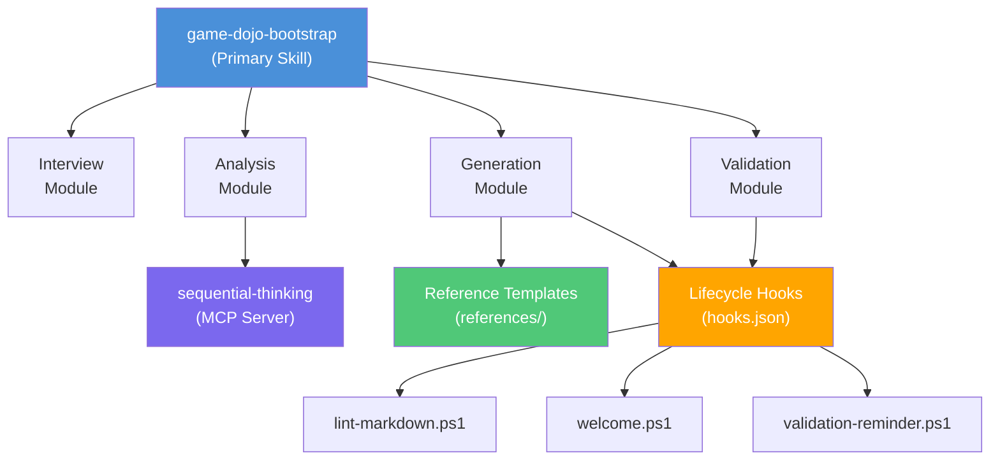
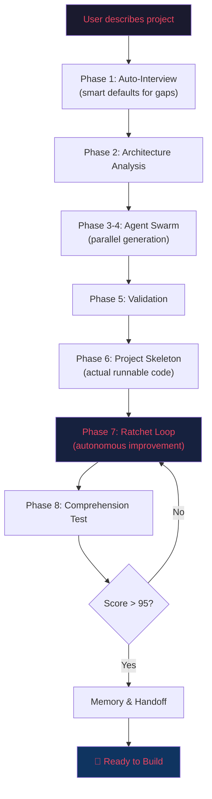
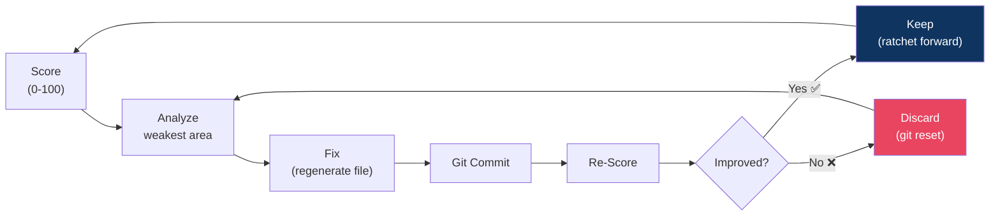
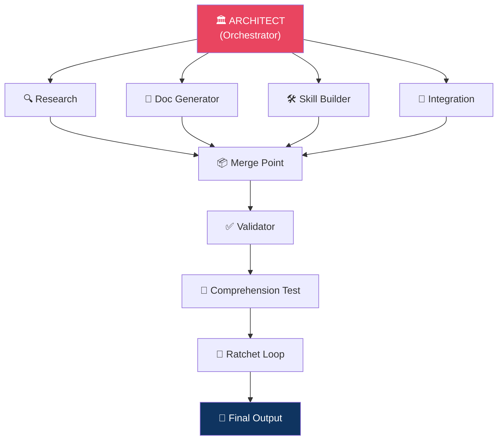
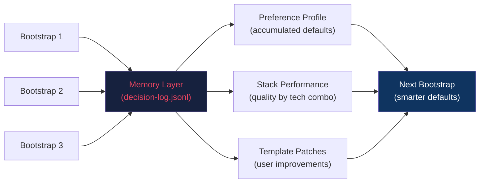

# Game Dojo Architecture

## System Overview

Game Dojo is a project bootstrapping system that transforms a user's project idea into a fully scaffolded workspace through a structured 5-phase pipeline. It operates as an Antigravity skill/plugin that leverages AI-driven interviews, template engines, and validation to produce production-ready project documentation and configuration.

### Pipeline Overview



| Phase | Input | Output | Key Responsibility |
|-------|-------|--------|-------------------|
| Discovery | User's project idea (free text) | Structured requirements JSON | Conduct interview, gather preferences |
| Analysis | Structured requirements | Architecture decisions, tech stack | Evaluate trade-offs, resolve conflicts |
| Generation | Architecture decisions + templates | Project files | Render templates, write files in order |
| Validation | Generated file tree | Validation report | Check completeness, consistency, references |
| Presentation | Validated workspace | Summary + next steps | Present results, suggest marketplace plugins |

---

## Component Architecture



### Component Descriptions

#### Interview Engine
Drives the structured discovery conversation with the user. Loads questions from the Question Catalog, adapts follow-up questions based on previous answers, and produces a normalized requirements object.

**Responsibilities:**
- Present categorized questions (project type, audience, features, tech preferences)
- Handle free-form answers and map them to structured data
- Detect ambiguity and ask clarifying follow-ups
- Produce a complete requirements specification

#### Analysis Engine
Transforms raw requirements into concrete architectural decisions. Uses sequential-thinking MCP for complex trade-off analysis.

**Responsibilities:**
- Select optimal tech stack based on requirements
- Determine architecture pattern (monolith, microservices, serverless)
- Resolve conflicts between user preferences and best practices
- Define the file generation manifest (what files to create, in what order)

#### Template Engine
Renders project files from reference templates, filling in content derived from the analysis phase.

**Responsibilities:**
- Load templates from `references/` directory
- Interpolate project-specific values into templates
- Handle conditional sections (e.g., API docs only for projects with backends)
- Maintain template section structure and frontmatter

#### File Writer
Writes generated content to the file system in dependency order.

**Responsibilities:**
- Create directory structure
- Write files atomically
- Trigger PostToolUse hooks (markdown linting)
- Track which files were created for the validation phase

#### Validation Engine
Verifies the generated workspace for completeness and consistency.

**Responsibilities:**
- Check all required files exist
- Validate cross-references between documents
- Ensure required sections are present in each document
- Verify frontmatter fields are populated
- Report warnings and errors

---

## Data Flow



### Data Schema Overview

**Requirements Object** (output of Discovery):
```
{
  projectName, projectType, description,
  audience: { primary, secondary },
  features: [ { name, priority, description } ],
  techPreferences: { frontend, backend, database, hosting },
  constraints: { budget, timeline, team_size }
}
```

**Architecture Decisions** (output of Analysis):
```
{
  stack: { frontend, backend, database, auth, hosting },
  pattern: "monolith" | "microservices" | "serverless",
  structure: { directories[], files[] },
  generationOrder: [ { path, template, dependencies[] } ]
}
```

---

## Skill Dependency Graph



---

## Extension Points

Game Dojo is designed to be extended without modifying core logic. Here are the primary extension surfaces:

### Adding New Templates

1. Create a new `.md` template in the `references/` directory
2. Include YAML frontmatter with `name`, `description`, and `requiredSections`
3. Use `{{placeholder}}` syntax for values the Template Engine should fill
4. Add the template to the generation manifest in the bootstrap skill
5. The Template Engine will automatically discover and use it

**Example:**
```markdown
---
name: SECURITY_PLAN
description: Security considerations and threat model
requiredSections: [threat-model, auth-strategy, data-protection]
---
# Security Plan
## Threat Model
{{threat_model_content}}
...
```

### Adding New Question Categories

1. Define a new category in the Question Catalog (JSON format)
2. Each question needs: `id`, `category`, `text`, `type` (text/select/multi), `options` (if applicable), `followUps`
3. Map the question's output field to the Requirements Object schema
4. The Interview Engine dynamically loads all categories at runtime

**Example:**
```json
{
  "id": "accessibility_level",
  "category": "accessibility",
  "text": "What level of accessibility compliance do you need?",
  "type": "select",
  "options": ["WCAG A", "WCAG AA", "WCAG AAA", "Not sure"],
  "mapsTo": "constraints.accessibility"
}
```

### Adding New Tech Stacks

1. Create a stack definition file in the skill's `stacks/` directory
2. Define the stack's components, default configurations, and file templates
3. Register the stack in the Analysis Engine's stack registry
4. Add any stack-specific templates to `references/`

**Stack definition format:**
```json
{
  "name": "nextjs-supabase",
  "displayName": "Next.js + Supabase",
  "components": {
    "frontend": { "framework": "Next.js", "version": "14+" },
    "backend": { "type": "serverless", "provider": "Vercel" },
    "database": { "engine": "PostgreSQL", "host": "Supabase" },
    "auth": { "provider": "Supabase Auth" }
  },
  "templates": ["nextjs-config", "supabase-schema", "vercel-config"],
  "scaffoldDirs": ["src/app", "src/components", "src/lib", "supabase/migrations"]
}
```

### Adding Lifecycle Hooks

1. Add a new hook entry to `.agents/hooks.json`
2. Create the corresponding script in `.agents/scripts/`
3. Scripts must output valid JSON matching the hook's expected response schema
4. See existing hooks for reference implementations

### Creating Plugins

1. Create a directory under `.agents/plugins/<plugin-name>/`
2. Add a `plugin.json` with at minimum `{ "name": "<plugin-name>" }`
3. Add rules in `rules/AGENTS.md` for plugin-specific behavior
4. Optionally add skills in `skills/` with `SKILL.md` instruction files

---

## Game Dojo 2.0 — Autonomous Architecture

### Autonomy Pipeline



### The Ratchet Loop Detail



### Agent Swarm Topology



### Memory Architecture


