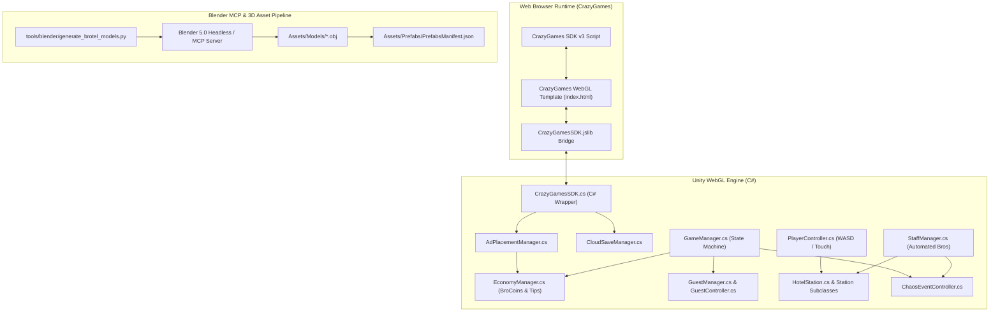
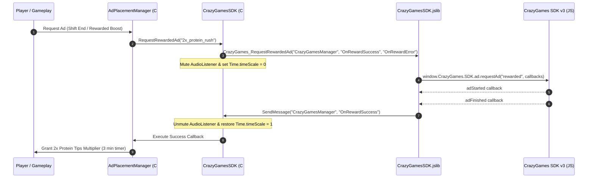

# System Architecture: BroTel: Gym Bro Hotel Tycoon

## 1. System Overview

BroTel is built on a modular, contract-first Unity WebGL architecture. The game combines a C# gameplay simulation engine with a JavaScript bridge communicating with the CrazyGames SDK v3 runtime. Stylized low-poly 3D assets are procedurally generated via an automated Blender 5.0 pipeline.



---

## 2. Component Interaction & Sequence Flow

### 2.1 Ad Lifecycle Sequence (Midgame & Rewarded)



---

## 3. Directory Structure & Domain Ownership

```
d:/Game_dojo/
├── .agents/                      # Agent skills, hooks, and MCP config
│   ├── skills/
│   │   ├── crazygames-sdk/
│   │   ├── blender-asset-pipeline/
│   │   ├── game-development/
│   │   └── team-orchestrator/
│   ├── hooks.json
│   └── mcp_config.json
├── .ai-team/                     # Multi-Developer Team Governance
│   ├── team.json                 # Team roster, roles, capacities
│   ├── plan.json                 # Milestone roadmap & task DAG
│   └── tasks/                    # Granular task specs with file bounds
├── .github/
│   └── CODEOWNERS                # Domain code review ownership
├── Assets/
│   ├── Scripts/
│   │   ├── Core/                 # [@gameplay-dev] Game state, economy
│   │   ├── Gameplay/             # [@gameplay-dev] Player, guests, stations, chaos, staff
│   │   ├── CrazyGames/           # [@monetization-dev] C# SDK wrapper & callbacks
│   │   └── Monetization/         # [@monetization-dev] Ad placement manager & cloud save
│   ├── Plugins/
│   │   └── WebGL/                # [@monetization-dev] CrazyGamesSDK.jslib
│   ├── WebGLTemplates/
│   │   └── CrazyGames/           # [@monetization-dev] index.html, style.css
│   ├── Models/                   # [@art-dev] 3D .obj/.mtl model files
│   ├── Materials/                # [@art-dev] Palette & material definitions
│   └── Prefabs/                  # [@art-dev] Prefab manifests & configurations
├── tools/
│   └── blender/                  # [@art-dev] Python 3D generation scripts
├── docs/                         # [@lead] PRDs, GDD, specifications
│   ├── PRD.md
│   ├── PROJECT_BRIEF.md
│   ├── REQUIREMENTS.md
│   ├── ARCHITECTURE.md
│   ├── GAME_DESIGN.md
│   ├── MONETIZATION_STRATEGY.md
│   └── contracts/                # [FROZEN] Frozen interface contracts
│       ├── crazygames-bridge-spec.json
│       ├── game-state-schema.json
│       └── hotel-station-interface.json
├── scripts/                      # Setup, build, asset generation, and local server
│   ├── setup.ps1
│   ├── build-webgl.ps1
│   ├── generate-3d-assets.ps1
│   ├── serve-local.ps1
│   └── verify-project.ps1
└── package.json
```
