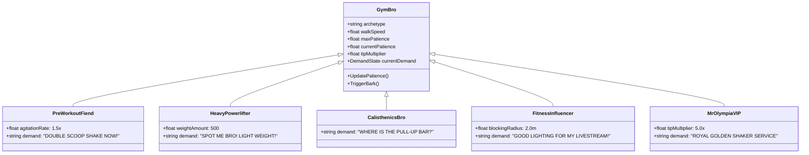

# Game Design Document (GDD): BroTel: Gym Bro Hotel Tycoon

## 1. Game Concept & Pillars
- **Genre**: 3D Isometric / Top-Down Arcade Tycoon & Time Management
- **Theme**: Slapstick gym culture, protein obsession, heavy lifting, and chaotic luxury hotel service
- **Platform**: CrazyGames (HTML5 WebGL)
- **Controls**: WASD / Arrow Keys or Point-and-Click / Touch Raycasting

---

## 2. Core Game Loop
1. **Check-In**: Swole guests enter the lobby and queue up at the Reception Desk. Player checks them in to collect deposits and assign suites.
2. **Fulfill Demands**:
   - Deliver freshly blended protein smoothies at the Protein Bar.
   - Spot powerlifters during heavy bench presses before barbells crash.
   - Restock towels and cold water in the Sauna Recovery Zone.
   - Clean bed suites and change linens after checkouts.
3. **Manage Chaos**:
   - Mop white chalk and protein powder explosion puddles before guests slip.
   - Repair cracked floor tiles from dropped 100lb dumbbells.
   - Break up mirror flexing stand-offs clogging hallways.
4. **Collect Earnings & Tips**: Earn BroCoins (base currency) and MuscleTips (performance bonus).
5. **Upgrade & Automate**:
   - Hire Bouncer Bro, Barista Bro, and Sweeper Bro.
   - Unlock higher-tier hotel floors and the VIP Golden Dumbbell Penthouse.

---

## 3. The 5 Gym Bro Archetypes

### Humorous Barks & Speech Bubbles
- Check-in: *"I NEED 5000 CALORIES RIGHT NOW!"*, *"DOES THIS ROOM HAVE A SQUAT RACK?"*
- Workout: *"LIGHT WEIGHT BABY!"*, *"AIN'T NOTHIN' BUT A PEANUT!"*, *"ONE MORE REP!"*
- Waiting too long: *"MY GAINS ARE WITHERING AWAY!"*, *"WHERE IS MY SPOTTER?!"*
- Departure: *"10/10 ANABOLIC RESORT"*, *"ADDED 2 INCHES TO MY BICEPS!"*
- Rage Quit: *"ZERO STARS! CORTISOL SPIKED!"*

---

## 4. The 5 Core Hotel Stations

### 4.1 Reception Desk
- **Role**: Entry point for all incoming guests.
- **Interaction**: Hold interaction button / stand in trigger zone for 1.5s to issue keycard.
- **Base Payout**: 50 BroCoins per check-in.
- **Upgrades**:
  - Level 1: Standard Desk (1 queue slot)
  - Level 2: Executive Desk (3 queue slots, +20% check-in speed)
  - Level 3: Gold Bicep Counter (5 queue slots, +50% check-in speed)

### 4.2 Protein Shake Bar
- **Role**: Refreshment station producing protein shakers.
- **Interaction**: Place order (1s), blender mixes shake (3s), pick up shake into inventory.
- **Ingredients**: Whey isolate, peanut butter, raw eggs, creatine monohydrate.
- **Upgrades**: Dual blenders, instant-dispense taps, golden shakers (+50% tips).

### 4.3 Squat Rack & Bench Arena
- **Role**: Core gym amenity where guests exercise.
- **Interaction**: Lifter occupies rack. A 5-second countdown timer with a vibrating barbell gauge appears. Player must interact within the window to spot lifter.
- **Success**: +100 BroCoins + 25 MuscleTips.
- **Failure**: Barbell drops, guest rage quits, tile cracks.

### 4.4 Reinforced Bed Suites
- **Role**: Recovery quarters for checked-in guests.
- **Interaction**: After guest checks out (60-second stay), bed turns `Dirty`. Player delivers clean towel and makes bed (2s interaction).
- **Upgrades**: Barbell-reinforced headboards, orthopedic protein foam mattresses.

### 4.5 Sauna Recovery Zone
- **Role**: High-temperature relaxation area.
- **Interaction**: Guests relax for 45s. Requires periodically pouring water over hot stones to maintain steam levels and restocking dry towels.
- **Upgrades**: Cedar paneling, cold plunge ice tubs, eucalyptus aromatherapy.

---

## 5. Economy & Balancing Curves

| Level | Shift Duration | Target Revenue | Guest Flow | Unlocks |
|---|---|---|---|---|
| **Shift 1** | 180s | 500 BroCoins | 6 Bros | Reception Desk, Bed Suites 1-2 |
| **Shift 2** | 180s | 1,200 BroCoins | 10 Bros | Protein Shake Bar, Bed Suite 3 |
| **Shift 3** | 180s | 2,500 BroCoins | 15 Bros | Squat Rack Arena, Sweeper Bro |
| **Shift 4** | 180s | 4,500 BroCoins | 20 Bros | Sauna Zone, Barista Bro |
| **Shift 5** | 180s | 8,000 BroCoins | 28 Bros | Bouncer Bro, VIP Mr. Olympia Guest |
