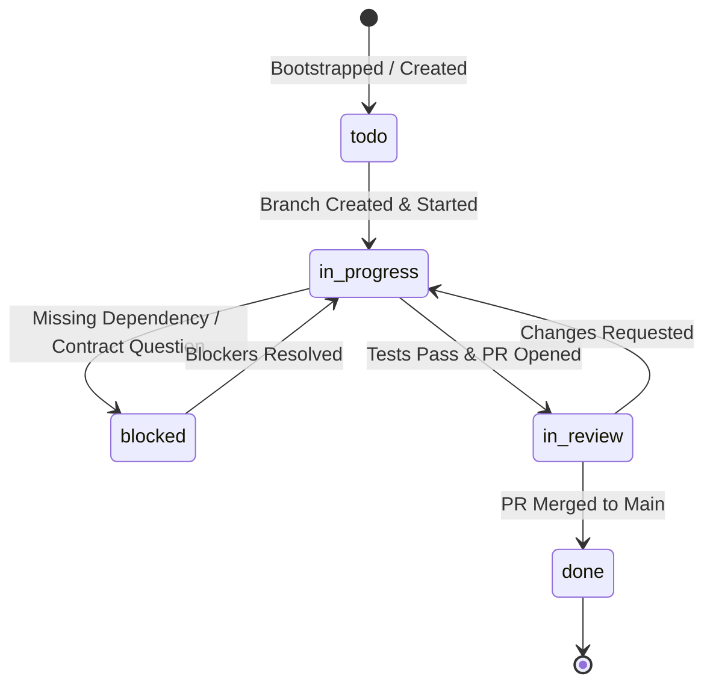

# 🥋 Game Dojo — Team Operations Guide

Operational handbook for human engineers and local AI agents working in a decentralized squad. Defines protocols for task dispatch, branch conventions, contract compliance, verification gates, and team member lifecycle.

---

## 1. Overview & Operating Model

Game Dojo Team Mode enables multi-developer human+AI squads to collaborate seamlessly within a shared codebase. In this model, every developer runs an independent **Antigravity IDE** instance with their own local AI coding agent.

Rather than relying on a centralized coordination server or unconstrained agent swarms that risk clobbering code, Game Dojo coordinates through **Git-native artifacts**, **strict file boundary manifests (`touchesFiles`)**, and **immutable shared contracts**.

### Core Architecture Pillars

1. **Decentralized Execution**: Every developer and local agent pair operates in complete isolation on a dedicated Git branch.
2. **Contract-First Development**: API routes and data models are defined in `docs/contracts/` before feature implementation starts.
3. **Bounded Autonomy**: Local agents read `.ai-team/tasks/<task-id>.json` and are strictly barred from modifying files outside `touchesFiles`.
4. **Git as Single Source of Truth**: State transitions, roster updates, and task completions are committed directly to Git.

---

## 2. Developer Onboarding into a Task Branch

Follow these steps when joining an active project or picking up a newly assigned task stream.

### Step 1: Workstation Setup & Identity Configuration

Verify your Git identity matches your roster profile in `.ai-team/team.json`:

```powershell
# Set your Git author details to match your team.json member ID
git config user.name "Vinod Krishna"
git config user.email "vinod@example.com"
```

Verify your local environment dependencies by executing the project setup script:

```powershell
.\scripts\setup.ps1
```

### Step 2: Task Inspection & Discovery

Inspect the `.ai-team/tasks/` directory to locate tasks assigned to you or unassigned tasks in `todo` status:

```powershell
# View tasks assigned to your handle
Get-ChildItem -Path .ai-team\tasks\*.json | ForEach-Object {
    $t = Get-Content $_.FullName | ConvertFrom-Json
    $isAssigned = ($t.assignedTo -eq "vinod" -or $t.assignee -eq "vinod" -or ($t.assignee -and $t.assignee.id -eq "vinod"))
    if ($isAssigned -and $t.status -eq "todo") {
        [PSCustomObject]@{
            Id       = $t.id
            Title    = $t.title
            Stream   = $t.stream
            Status   = $t.status
        }
    }
} | Format-Table -AutoSize
```

### Step 3: Branch Creation Convention

Every task must be implemented on an isolated branch following the standard naming convention:

```
feature/<task-id>-<slug>   # Canonical Game Dojo standard
feat/<task-id>-<slug>      # Conventional commit variant
fix/<task-id>-<slug>       # Bugfix branches
refactor/<task-id>-<slug>  # Refactoring branches
task/<task-id>-<slug>      # Task-runner variant
```

Example checkout for task `task-101`:

```powershell
git checkout main; git pull origin main
git checkout -b feature/task-101-dashboard-feed
```

---

## 3. Local Agent Task Recognition & Context Binding

When you open Antigravity IDE on a task branch, the local AI agent automatically executes the **Team Boundary Protocol**.

### How the Local Agent Discovers Context

1. **Branch Detection**: The agent invokes `git branch --show-current` or `git rev-parse --abbrev-ref HEAD` to identify the active branch name (e.g. `feature/task-101-dashboard-feed` or `feat/task-101-dashboard-feed`).
2. **Task ID Extraction**: The agent extracts the task key `task-101` from the branch prefix.
3. **Manifest Loading**: The agent loads `.ai-team/tasks/task-101.json` to extract:
   - `touchesFiles` / `allowedPaths`: The strictly permitted list of file targets.
   - `contractDependencies`: The shared schemas that must not be broken.
   - `verificationCommand` / `verification`: Prescribed test and lint commands.
4. **Roster Cross-Reference**: The agent checks `.ai-team/team.json` to verify team role permissions and domain ownership against `.github/CODEOWNERS` (or root `CODEOWNERS`).

### The Boundary Protocol (`touchesFiles` / `allowedPaths` Invariant)

Local AI agents must strictly adhere to the following rules:

- **Modification Containment**: You may only write or edit files listed in the task's `touchesFiles` (or `allowedPaths`) property.
- **Strict Prohibition on Foreign Files**: Never modify files belonging to other active tasks or other team members without an explicit user override instruction.
- **Contract Read-Only Access**: You may read `docs/contracts/` files to generate client types or server handlers, but you must NEVER modify shared contract files directly on a feature branch.
- **Handling Out-of-Scope Needs**: If your feature requires altering an unlisted file (e.g., adding a common utility in `src/utils/math.ts`), you must notify the developer and require updating `.ai-team/tasks/<task-id>.json` before proceeding.

---

## 4. Task Status Lifecycle

Tasks progress through four linear states plus a conditional blocked state:



### State Definitions & Trigger Criteria

| Status | Meaning | Transition Trigger | Actions Required |
|---|---|---|---|
| `todo` | Ready in backlog | Bootstrapping or backlog creation | Assigned to team member, dependencies defined |
| `in_progress` | Active development | Branch checkout & first edit | Developer begins implementation; agent confines to `touchesFiles` |
| `blocked` | Cannot make progress | Dependency stall or contract conflict | Flag blockers in task JSON, alert team lead |
| `in_review` | Verification complete | All tests pass, PR opened | Open GitHub PR, ping CODEOWNERS for review |
| `done` / `completed` | Shipped to trunk | PR approved and merged | Task file and plan.json updated with merge commit |

### Transitioning Task State via PowerShell

To transition task `task-101` to `in_progress`:

```powershell
# Transition task manifest
$taskPath = ".ai-team\tasks\task-101.json"
$task = Get-Content $taskPath | ConvertFrom-Json
$task.status = "in_progress"
$task | ConvertTo-Json -Depth 10 | Set-Content $taskPath -Encoding UTF8

# Synchronize plan.json taskIndex if present
$planPath = ".ai-team\plan.json"
if (Test-Path $planPath) {
    $plan = Get-Content $planPath | ConvertFrom-Json
    $matched = $plan.taskIndex | Where-Object { $_.id -eq $task.id }
    if ($matched) { $matched.status = "in_progress" }
    $plan | ConvertTo-Json -Depth 10 | Set-Content $planPath -Encoding UTF8
}

git add .ai-team; git commit -m "chore(task): set task-101 to in_progress"
```

To transition task `task-101` to `in_review`:

```powershell
# Transition task manifest
$taskPath = ".ai-team\tasks\task-101.json"
$task = Get-Content $taskPath | ConvertFrom-Json
$task.status = "in_review"
$task | ConvertTo-Json -Depth 10 | Set-Content $taskPath -Encoding UTF8

# Synchronize plan.json taskIndex if present
$planPath = ".ai-team\plan.json"
if (Test-Path $planPath) {
    $plan = Get-Content $planPath | ConvertFrom-Json
    $matched = $plan.taskIndex | Where-Object { $_.id -eq $task.id }
    if ($matched) { $matched.status = "in_review" }
    $plan | ConvertTo-Json -Depth 10 | Set-Content $planPath -Encoding UTF8
}

git add .ai-team; git commit -m "chore(task): set task-101 to in_review"
```

---

## 5. Submitting PRs with Automated Verification

Before a branch can be proposed for review, both developer and local agent must complete the verification pipeline.

### Step 1: Run Prescribed Verification Commands

Execute the task's specific verification commands defined in its manifest:

```powershell
# Run the verification commands specified in the task JSON
npm run lint -- src/components/dashboard
npm test -- tests/components/RecipeFeed.test.tsx
```

### Step 2: Contract Conformance Check

Verify that no shared contracts in `docs/contracts/` were altered or violated:

```powershell
# Ensure docs/contracts remains identical to main
git diff origin/main -- docs/contracts
```

If any diff appears in `docs/contracts`, the PR will be rejected by CI unless tagged with `contract-migration`.

### Step 3: Commit and Push

Use conventional commit messages referencing the task ID:

```powershell
git add src/components/dashboard tests/components/RecipeFeed.test.tsx
git commit -m "feat(dashboard): implement paginated recipe feed (task-101)"
git push -u origin feature/task-101-dashboard-feed
```

### Step 4: Open Pull Request with Structured Description

Open a Pull Request into `main`. The PR description must adhere to this standard template:

```markdown
## Summary
Closes task-101: Build Dashboard Recipe Feed Component

## Touched Files (Scope Conformance)
- src/components/dashboard/RecipeFeed.tsx
- src/components/dashboard/RecipeCard.tsx
- src/styles/dashboard.module.css
- tests/components/RecipeFeed.test.tsx

## Contract Conformance
- Consumes: `docs/contracts/api-spec.json#/paths/~1recipes~1feed`
- Breaking Changes: None

## Verification Record
- Lint: Passed with 0 errors
- Tests: 4/4 passing (100% coverage on new components)
```

---

## 6. Team Member Management & Task Rebalancing

Dynamic team composition requires clean onboarding, graceful offboarding, and active task rebalancing.

### Onboarding a New Team Member

1. **Add Member to `.ai-team/team.json`**:
   Add the new engineer's identity, role, and domain responsibilities:
   ```json
   {
     "id": "maya",
     "name": "Maya Patel",
     "email": "maya@example.com",
     "gitUser": "@maya",
     "role": "fullstack-engineer",
     "type": "human",
     "availability": "active",
     "maxConcurrentTasks": 2,
     "assignedTaskIds": ["task-301"],
     "assignedDomains": ["src/lib", "src/hooks"],
     "capabilities": ["typescript", "react", "nextjs"]
   }
   ```
2. **Update `.github/CODEOWNERS`**:
   Ensure the new engineer is designated as a reviewer for their assigned domains:
   ```
   src/lib/     @maya
   src/hooks/   @maya
   ```
3. **Commit & Push to Main**:
   Merge onboarding configuration directly to `main` so all workstations receive the updated roster.

### Offboarding a Team Member

1. **Audit Active Tasks**:
   Identify tasks currently in `in_progress` or `todo` assigned to the departing member:
   ```powershell
   Get-ChildItem -Path .ai-team\tasks\*.json | ForEach-Object {
       $t = Get-Content $_.FullName | ConvertFrom-Json
       $isAssigned = ($t.assignedTo -eq "alex" -or $t.assignee -eq "alex" -or ($t.assignee -and $t.assignee.id -eq "alex"))
       if ($isAssigned -and -not ($t.status -in @("done", "completed"))) {
           Write-Output "$($t.id): $($t.title) ($($t.status))"
       }
   }
   ```
2. **Handle In-Flight Branches**:
   - If work is partial, push the working branch `feature/<task-id>-*` (or `feat/<task-id>-*`) to origin.
   - Note progress in task manifest under a `handoffNotes` field.
3. **Reassign Tasks**:
   Update `assignedTo` (and `assignee`) in affected `.ai-team/tasks/*.json` to the new owner or set to `"unassigned"` with status `"todo"`. Also synchronize `plan.json` `taskIndex` if present.
4. **Update `.ai-team/team.json` and `.github/CODEOWNERS`**:
   Remove member from roster and transfer domain ownership.

### Task Rebalancing & Deadlock Resolution

When a developer finishes early or a critical path task stalls:

1. **Acyclicity Check**:
   Run `.agents/scripts/validate-dag.ps1` to confirm the task graph remains a Directed Acyclic Graph (DAG) with zero circular `dependencies` references.
2. **Unblocking Queued Tasks**:
   When task `task-201` moves to `done` / `completed`, any task listing `task-201` in `dependencies` (or `blockedBy`) must have `task-201` marked resolved or removed from its prerequisite list.
3. **Splitting Oversized Tasks**:
   If a task's `touchesFiles` spans more than 8 files across multiple domains, split it into two subtasks (e.g., `task-201A` for controller handlers and `task-201B` for repository persistence) to maintain isolation.

---

## 7. Conflict Resolution & Edge Cases

### Accidental Boundary Breach
If an agent accidentally modifies a file outside `touchesFiles`, run:

```powershell
# Restore unmodified version of external file from main
git checkout origin/main -- path/to/foreign/file.ts
```

### Shared Contract Evolution (RFC Process)
When an existing contract cannot satisfy a new requirement:

1. **Do NOT edit `docs/contracts/` on a feature branch.**
2. Open a dedicated RFC branch: `contract/rfc-<topic>`.
3. Modify the contract and submit a PR tagged with `contract-rfc`.
4. Require approval from all domain leads in `.ai-team/team.json`.
5. Once merged to `main`, all feature branches rebase on `main` before updating code.
